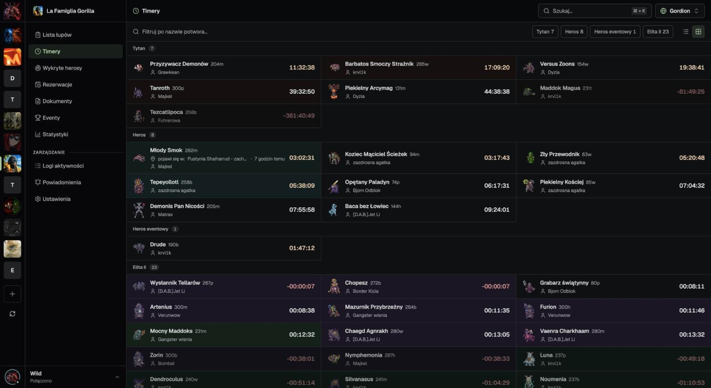
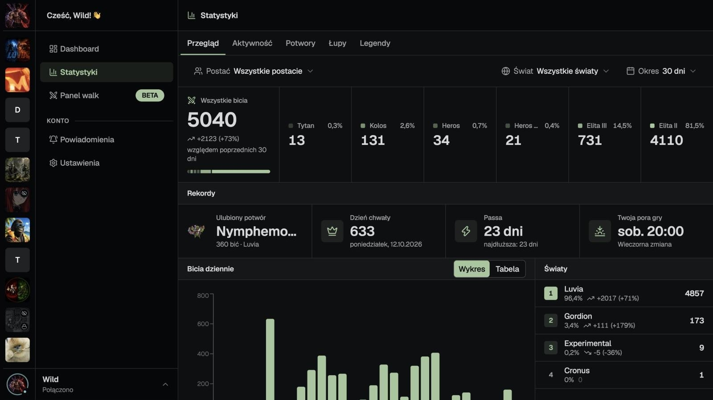
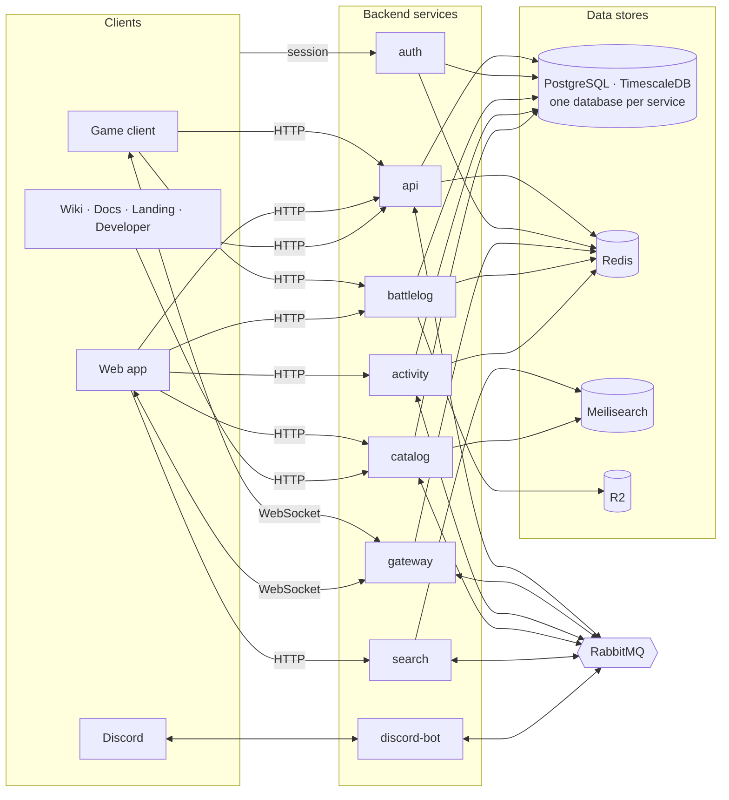

# Lootlog

Lootlog is an open-source companion for [Margonem](https://www.margonem.pl), a
browser MMORPG. An in-game client captures supported gameplay events, a set of
backend services turns them into durable records, and a web workspace and a
Discord bot give organized groups shared timers, loot history, battle analysis,
and coordination without copying anything by hand.

[lootlog.pl](https://lootlog.pl) ·
[User documentation](https://docs.lootlog.pl) ·
[Developer portal](https://developer.lootlog.pl) ·
[Contributor guide](CONTRIBUTING.md)



Lootlog is released under MIT. It is an unofficial community project and does
not automate character movement, combat, or player decisions.

## Product surfaces

- **Game client:** userscript and browser extension embedded in supported
  Margonem pages.
- **Web:** authenticated personal and organization workspace.
- **Discord bot:** organization installation, membership synchronization,
  notifications, and commands.
- **Wiki:** public item, NPC, and player knowledge.
- **Landing and Docs:** product introduction, legal pages, and the user guide.
- **Developer:** API key management, integration guides, and API reference.



## Architecture



Eight independently deployed Bun services share one bootstrap, one container
image definition, and one messaging package. Each service that stores data owns
its own database; other services reach that data through versioned HTTP
contracts or RabbitMQ facts.

The decisions that shape the system are recorded as
[architecture decision records](docs/adr/README.md):

- [The Organization is the security boundary](docs/adr/0001-organization-is-the-security-boundary.md)
- [One writer per data domain](docs/adr/0002-one-writer-per-data-domain.md)
- [HTTP contracts are the source of generated clients](docs/adr/0003-http-contracts-generate-clients.md)
- [Fail fast on broker loss and keep consumers idempotent](docs/adr/0004-fail-fast-messaging-and-idempotent-consumers.md)
- [The game client stays behind a runtime bridge](docs/adr/0005-game-client-runtime-bridge.md)
- [Releases promote immutable artifacts](docs/adr/0006-immutable-release-artifacts.md)

Architectural trade-offs are resolved in a fixed order: do not interfere with
the game or lose accepted data, then game-client performance, security and
Organization isolation, real-time reliability, infrastructure cost,
maintainability, and only then future flexibility.

## Repository layout

```text
apps/
├── activity/            Activity and audit service
├── api/                 Organization, loot, timer, chat, and coordination API
├── auth/                Discord authentication and session service
├── battlelog/           Battle ingestion, storage, and statistics
├── catalog/             Margonem items and NPCs with a search projection
├── developer/           Developer portal and integration documentation
├── discord-bot/         Discord integration
├── docs/                User documentation
├── game-client/         In-game React client and Margonem runtime bridge
├── gateway/             Bun WebSocket presence and real-time fan-out
├── landing/             Public product site and legal pages
├── search/              Meilisearch-backed public search API
├── traffic-splitter/    Shared edge router for dev.lootlog.pl and lootlog.pl
├── web/                 Authenticated React web app
└── wiki/                Public Margonem knowledge app

packages/
├── battle-processor/    Battle normalization and processing
├── cli/                 Environment and maintenance commands
├── client/              Generated HTTP clients and realtime client
├── database/            Shared database utilities
├── datetime/            Shared date and time utilities
├── domain/              Browser-safe domain logic
├── game-client-api/     Public types for game-client integrations
├── instrumentation/     Service bootstrap and observability
├── margonem/            Margonem domain types and helpers
├── meilisearch/         Meilisearch client and batch consumer
├── messaging/           RabbitMQ transport
├── protocol/            Realtime and RabbitMQ wire contracts
├── schema/              Shared schemas and browser-safe types
├── sdk/                 Public TypeScript SDK
├── typescript-config/   Shared TypeScript configuration
└── ui/                  Shared UI components and styles

docs/
├── adr/                 Architecture decision records
└── operations.md        Releases, rollback, and recovery
```

## Technology

- Bun workspaces and Turborepo
- TypeScript, React 19, Vite, TanStack Start, and TanStack Router/Query
- Effect 4 HttpApi, Better Auth, and native Bun HTTP/WebSocket servers
- PostgreSQL, TimescaleDB, Drizzle, and R2
- RabbitMQ, Redis, native WebSockets, and Meilisearch
- Oxlint, Oxfmt, Vitest, and GitHub Actions

## Local setup

Requirements:

- Node.js 26.8.2
- Bun 1.4.4
- Docker with Docker Compose

```bash
git clone https://github.com/lootlog/monorepo.git
cd monorepo
bun install
bun run env:generate
docker compose up -d
bun run db:api:migrate:dev
bun run db:activity:migrate:dev
bun run db:auth:migrate:dev
bun run db:catalog:migrate:dev
bun run db:battlelog:migrate:deploy
bun run dev
```

The environment generator shares `ACTIVITY_EVENT_SIGNATURE_SECRET` between the
Gateway publisher and Activity consumer. With `--skip-existing`, it reuses the
secret from existing files and leaves those files unchanged. If existing secrets
differ, align the value in the root, Gateway, and Activity `.env` files before
running the generator again. `--force` regenerates all environment files,
including credentials and manually configured values.

`docker-compose.yml` starts local infrastructure: five PostgreSQL-compatible
databases, RabbitMQ, Redis, Meilisearch, and Traefik. It is not a supported
production deployment, and self-hosting is community-supported until the
project ships a tested distribution.

## Common commands

```bash
bun run dev
bun run build
bun run lint
bun run typecheck
bun run test
bun run test:e2e
bun run format
bun run format:check
```

Additional workspace-specific commands are declared in each workspace's
`package.json`.

## Testing

A test earns its place by naming a realistic regression and failing when that
regression occurs. Tests protect observable behavior, business invariants,
authorization boundaries, and integration contracts; tests that restate the
implementation, the type system, or a framework are removed rather than
written. Integration and end-to-end tests run against real PostgreSQL and
Dragonfly containers, with fakes only at genuine external boundaries.

## Releases and operations

Merging a pull request deploys the affected targets to development. Production
is a manual, approved promotion of an immutable image or Cloudflare deployment,
and a rollback restores the previous revision without rebuilding it. See
[Operations](docs/operations.md) for the release workflows, backend artifacts,
and message recovery.

## Contributing and security

Read [CONTRIBUTING.md](CONTRIBUTING.md) and [AGENTS.md](AGENTS.md) before changing
code. Report vulnerabilities privately through
[GitHub Security Advisories](https://github.com/lootlog/monorepo/security/advisories/new).
Do not open public issues for suspected vulnerabilities.

General issues belong in the
[Lootlog monorepo issue tracker](https://github.com/lootlog/monorepo/issues).

## License

Code in this repository is licensed under the [MIT License](LICENSE). Margonem
artwork and game assets remain the property of Garmory sp. z o.o.
